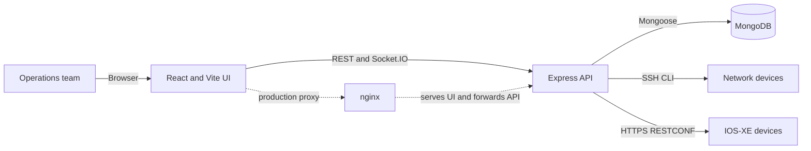

# Network Automation Center

<p align="center">
  <strong>A practical command center for network inventory, configuration control, and topology discovery.</strong><br>
  Manage multi-vendor infrastructure from one web application, with a focus on safe operations and an auditable workflow.
</p>

<p align="center">
  
  
  
  
</p>

Network Automation Center (NAC) is a browser-based application for teams that
operate switches, routers, wireless access points, controllers, and firewalls.
It brings inventory, encrypted credentials, configuration backups, topology
discovery, scheduled automation, and audit history into one place.

> **Important:** NAC can execute commands and restore configurations on real
> network equipment. Start with read-only discovery and test devices, review
> every change, and keep out-of-band access before using write operations.

## At a glance

| Capability | What it provides |
| --- | --- |
| Device inventory | Searchable multi-vendor inventory, connection tests, and per-device command overrides |
| Sites and monitoring | Organize devices by site and location; review online/offline reachability and device health |
| Bulk device import | Download an Excel template, preview rows, and import up to 200 devices per batch |
| Configuration control | Backups, meaningful version history, diffs, templates, and operator-triggered restore/push workflows |
| Network topology | Verify targets and discover links using CDP and LLDP; combine results when both protocols are available |
| Operations | Concurrent jobs, live progress, cancellation, cron schedules, dashboard metrics, and audit events |
| Access control | First-user administrator setup and `admin`, `operator`, and `viewer` roles |
| Deployment | Local Windows development or Docker Compose with MongoDB, API, and nginx-served frontend |

## Architecture



In production, nginx serves the compiled frontend and proxies API and websocket
traffic to the backend. The backend connects directly to managed equipment;
devices do not need a NAC agent. Make sure the host/container running the backend
can reach device management addresses and required SSH or HTTPS ports.

### Stack

| Layer | Technology |
| --- | --- |
| Frontend | React 18, React Router, Vite, Axios |
| Backend | Node.js (ES modules), Express 4, Socket.IO |
| Database | MongoDB 7, Mongoose 8 |
| Device connectivity | SSH via `ssh2`; HTTPS RESTCONF for supported IOS-XE devices |
| Deployment | Docker Compose; nginx serves the production frontend |

## Features

### Inventory and credential vault

- Track switches, routers, access points, wireless LAN controllers, and firewalls.
- Store vendor, model, location, tags, and device-specific CLI command overrides.
- Test connectivity, report latency, identify drivers, and record reachability.
- Encrypt device passwords, enable passwords, and SSH key material before storage.

### Sites, monitoring, and bulk import

- Create and manage named sites with an optional code, region, address,
  description, and active status. Assign devices to a site and location, then
  filter the inventory by either value.
- Use Monitoring to review reachable (online) and unreachable (offline) devices.
  Reachability is updated by device connection tests; adding a device does not
  test its connection automatically.
- On the Devices page, choose **Download Excel template** to get an `.xlsx`
  workbook with a `Devices` sheet and a `Reference` sheet of allowed values.
  Fill one device per row on `Devices`, then choose **Import Excel** to preview
  and import it. The importer accepts up to 200 rows per batch and reports
  validation or creation failures per row; valid rows can still be added.
- Required spreadsheet columns are `name`, `host`, `vendor`, `deviceType`, and
  `credential`. The `credential` value must match an existing credential name.
  Optional columns include `port`, `protocol`, `driver`, `model`, `platform`,
  `osVersion`, `site`, `location`, `tags`, and `notes`. Separate multiple tags
  with commas. The importer does not create credentials or overwrite devices.

### Configuration lifecycle

- Capture configurations through vendor CLI commands or RESTCONF.
- Create a new version only when normalized configuration content changes.
- Compare versions with line-based diffs and change summaries.
- Preview Handlebars templates and extract template variables before pushing.
- Restore a saved configuration through the relevant device driver, with an
  optional follow-up backup.

### Topology discovery

- Enter a single IP address or an IP range and select the credentials to use.
- Verify reachability before starting topology discovery.
- Discover neighbors through CDP and LLDP, merging results when devices report
  both protocols.
- Receive a clear unreachable-device error when a target cannot be contacted.
- Discovery requires reachable devices and credentials with permission to run
  the relevant neighbor commands. Validate access on a small target set first.

### Jobs and operations

- Run backups, commands, template pushes, and restores across selected devices.
- Bound parallel device work with `JOB_CONCURRENCY`.
- Follow job progress in real time with Socket.IO and cancel queued/in-progress
  work cooperatively.
- Schedule recurring backups or template pushes using cron expressions.
- Review audit events, job outcomes, device reachability, stale backups, and
  configuration capture activity on the dashboard.

## Requirements

- Node.js 18.17 or newer and npm.
- MongoDB 7, either local, remote, or provided through Docker.
- Docker Desktop / Docker Engine with Compose for the container deployment.
- Network routing and firewall access from the backend host to device management
  interfaces for real discovery and automation.

## Run locally on Windows

The repository includes `run-local.ps1`, which opens separate PowerShell windows
for the local MongoDB helper, backend, and frontend. From the project directory:

```powershell
Set-ExecutionPolicy -Scope Process -ExecutionPolicy Bypass
.\run-local.ps1
```

Then open <http://localhost:5173/login>. The API health endpoint is
<http://localhost:5000/api/health>.

The first account registered in an empty database becomes the administrator.
The local helper uses the repository's development database setup. For a shared
or persistent database, configure a MongoDB instance and the backend environment
variables instead of relying on development-only data.

### Manual local setup

1. Start MongoDB and make it available at the URI configured for the backend.
2. In `backend`, install dependencies, configure `backend/.env`, and start the
   API:

   ```powershell
   Set-Location .\backend
   Copy-Item .env.example .env
   npm install
   npm run gen:key
   npm run dev
   ```

   Put strong, unique `JWT_SECRET` and `CREDENTIAL_KEY` values in the backend
   environment file. `CREDENTIAL_KEY` must be 64 hexadecimal characters. Keep
   the key stable: changing it makes previously encrypted device credentials
   unreadable.
3. In another terminal, install and run the frontend:

   ```powershell
   Set-Location .\frontend
   npm install
   npm run dev
   ```

The Vite development server is available at `http://localhost:5173`; its API
proxy targets the backend on port 5000.

## Run with Docker Compose

Create a root `.env` file from `.env.example`, then set strong secrets. Generate
two independent 32-byte hexadecimal secrets with Node.js:

```powershell
Copy-Item .env.example .env
node -e "console.log(require('crypto').randomBytes(32).toString('hex'))"
```

Use one generated value for `JWT_SECRET` and a second for `CREDENTIAL_KEY`, then
start the stack:

```powershell
docker compose up -d --build
```

Open <http://localhost:8080> and create the first administrator. Useful
management commands:

```powershell
docker compose ps
docker compose logs -f backend
docker compose down
```

The Compose setup persists MongoDB data in the `mongo-data` volume. `docker
compose down -v` removes that volume and its data; use it only when you intend
to delete the database.

## Configuration

The backend reads environment variables from its environment (and its local
`.env` file in development). The Compose deployment reads the root `.env` file.
See `backend/.env.example` and `.env.example` for the templates.

| Variable | Default | Purpose |
| --- | --- | --- |
| `NODE_ENV` | `development` | Production mode enforces stronger secrets and hides internal errors |
| `PORT` | `5000` | Backend HTTP port |
| `MONGODB_URI` | `mongodb://127.0.0.1:27017/network_automation` | MongoDB connection string |
| `JWT_SECRET` | Development fallback | JWT signing secret; set a unique strong value outside local experiments |
| `JWT_EXPIRES_IN` | `12h` | JWT lifetime |
| `CREDENTIAL_KEY` | Development fallback | 64-hex-character AES-256-GCM key for stored device secrets |
| `CORS_ORIGIN` | `http://localhost:5173` | Comma-separated allowed browser origins |
| `SSH_READY_TIMEOUT_MS` | `20000` | SSH connection readiness timeout |
| `SSH_COMMAND_TIMEOUT_MS` | `60000` | Default device command timeout |
| `SSH_LONG_COMMAND_TIMEOUT_MS` | `180000` | Timeout for longer operations such as backups |
| `JOB_CONCURRENCY` | `5` | Maximum devices processed concurrently per job |
| `RESTCONF_VERIFY_TLS` | `false` | Whether RESTCONF TLS certificates are verified |
| `LOG_LEVEL` | `info` | Application log verbosity |
| `HTTP_PORT` | `8080` (Compose) | Host port for the frontend container |

## Supported device drivers

| Driver | Platforms | Connection | Backup / write support |
| --- | --- | --- | --- |
| `cisco_ios` | Cisco IOS / IOS-XE switches, routers, APs, and supported WLCs | SSH | CLI backup and configuration push/restore |
| `cisco_nxos` | Cisco Nexus | SSH | CLI backup and configuration push/restore |
| `cisco_wlc` | Cisco AireOS controllers | SSH | WLC command backup and supported configuration operations |
| `cisco_restconf` | IOS-XE with RESTCONF enabled | HTTPS | RESTCONF retrieval; read-only |
| `aruba_os` | Aruba AOS-S, AOS-CX, and supported ArubaOS controllers | SSH | CLI backup and supported configuration operations |
| `juniper` | Junos switches, routers, and SRX | SSH | CLI backup and supported configuration operations |
| `ubiquiti` | EdgeSwitch / EdgeMAX | SSH | CLI backup and supported configuration operations |
| `generic_ssh` | Other SSH-based network equipment | SSH | Commands are configurable per device |

Driver behavior depends on device OS version, user privilege, and CLI prompts.
Command overrides are available for prompts, paging, identification, backup,
configuration entry/exit, and saving. Test the exact commands on your equipment
before enabling write operations.

## Access roles

| Role | Intended use |
| --- | --- |
| `admin` | User and platform administration, plus operational access |
| `operator` | Device operations, jobs, configuration changes, and schedules |
| `viewer` | Read-only access to permitted inventory and operational views |

The first account created when the user collection is empty is assigned the
administrator role. Registration is restricted after initial setup.

## API overview

API routes are mounted under `/api`. Authentication uses a bearer JWT except
for login, registration during setup, setup status, and health checks.

| Area | Common endpoints |
| --- | --- |
| Authentication | `POST /api/auth/login`, `POST /api/auth/register`, `GET /api/auth/setup-status` |
| Devices | `GET/POST /api/devices`, `POST /api/devices/bulk`, `GET/PATCH/DELETE /api/devices/:id`, `POST /api/devices/:id/test`, `POST /api/devices/:id/backup`, `GET /api/devices/monitoring` |
| Sites | `GET/POST /api/sites`, `PATCH/DELETE /api/sites/:id` |
| Topology | `POST /api/topology/verify`, `POST /api/topology/build` |
| Credentials | `/api/credentials` and `/api/credentials/:id` |
| Configurations | `/api/configs`, `/api/configs/:id`, `/api/configs/diff`, `POST /api/configs/:id/restore` |
| Templates | `/api/templates`, `POST /api/templates/:id/preview`, `POST /api/templates/:id/push` |
| Jobs | `/api/jobs`, `/api/jobs/:id`, `POST /api/jobs`, `POST /api/jobs/:id/cancel` |
| Schedules | `/api/schedules` |
| Dashboard and audit | `/api/dashboard/summary`, `/api/audit` |
| Users | `/api/users` |
| Health | `GET /api/health` |

Socket.IO connects at `/socket.io` with the JWT in the connection auth payload.
Clients can subscribe to job progress events.

## Security and operations

- User passwords are hashed; device credentials are encrypted with AES-256-GCM.
- Keep `.env` files and generated credentials out of source control. Never put
  real network passwords, keys, tokens, or production database dumps in issues
  or commits.
- Use unique secrets in production and protect `CREDENTIAL_KEY` with a secret
  manager and secure backup. Key rotation requires a deliberate data migration.
- Put the app behind HTTPS for shared or internet-facing use. Restrict access to
  the backend and MongoDB ports; expose only the intended reverse-proxy entry.
- Apply least-privilege network device accounts and restrict backend egress to
  required management networks.
- Back up the `network_automation` database and test restores. Scheduled device
  backups are not substitutes for backups of NAC's own database.
- Keep a single scheduler instance in multi-replica deployments unless you add
  leader election; otherwise each backend replica may run the same schedule.

## Development and tests

```powershell
Set-Location .\backend
npm test
npm run smoke

Set-Location ..\frontend
npm run lint
npm run build
```

Backend tests use Node's built-in test runner. The smoke test exercises API
flows against an in-memory MongoDB. Frontend lint and build commands verify the
React source and production bundle.

## Known limitations

- The RESTCONF driver is read-only; configuration writes require a compatible
  SSH driver.
- Topology discovery and device automation have not been validated against every
  vendor/firmware combination; test against representative lab devices first.
- Some controller-managed equipment exposes limited CLI access and may require
  `generic_ssh` command overrides or management through its controller.
- Job cancellation is cooperative; an operation already running on a device may
  finish before cancellation takes effect.
